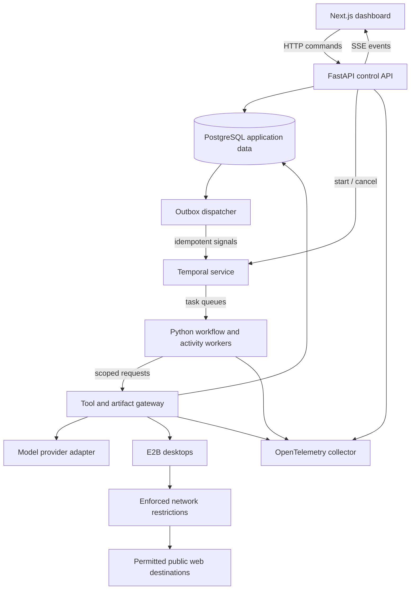

# General-purpose multi-agent workspace

Status: agreed design, before implementation.

See [visual architecture and technical decisions](visual-architecture.md) for the stack diagram, execution sequence, conflict-resolution flow, and decision tradeoffs.

## Product and scope

A user submits an everyday task. A coordinator interprets the goal, identifies missing essentials, and assigns work to agents operating separate E2B desktops. The user watches desktops, task progress, messages, and artifacts, and can redirect or cancel the run. The coordinator combines verified findings into a sourced deliverable.

The application is general purpose within its initial capabilities: public-web research and artifact creation. Roles are assigned dynamically. Weekend-trip planning is the first acceptance scenario, not a hard-coded workflow. Product comparison and outing research are secondary generality checks.

Initial limits: private beta, at most three active worker desktops per run, default ten-minute execution deadline, configurable model budget, and 24-hour development retention. No personal-site logins, reservations, purchases, external messages, or autonomous publishing. A task requiring unsupported capabilities returns an explanation or partial result.

## Architecture



### Components

| Component | Responsibility |
|---|---|
| Next.js, TypeScript, Tailwind | Prompt entry, interpreted constraints, desktop views, task graph, communication timeline, artifacts, intervention |
| FastAPI and Pydantic | Authentication integration, request validation, run ownership, commands, event stream |
| Temporal and Python SDK | Durable run lifecycle, activity scheduling, bounded retry, cancellation, deadlines, worker recovery |
| Python agent workers | Model-directed observe/act loops, research, proposals, handoffs, artifact synthesis |
| PostgreSQL, SQLAlchemy, Alembic | Application state, accepted plan, messages, outbox, events, permissions, budgets, usage |
| Tool/artifact gateway | Identity checks, authorization, schema validation, budget admission, audit events, model and desktop adapters |
| E2B Desktop | Isolated computers, screenshots, desktop actions, live views |
| Private object storage | Screenshots and artifacts; local filesystem adapter during development |
| OpenTelemetry | Correlated traces across run, task, message delivery, model request, and tool call |

Temporal owns execution history; PostgreSQL owns application facts and accepted plan state. Do not maintain competing workflow engines. Start with an explicit Python agent loop rather than adding LangGraph. Temporal's own persistence is separate from application tables, even if local development uses the same PostgreSQL server with separate databases.

## Execution and communication

1. Authenticate the user and create a run in `draft` with its goal, constraints, limits, and permission profile.
2. Ask for missing essentials; show interpreted constraints. Start execution only after the request is sufficiently specified.
3. Start a Temporal workflow using a stable workflow ID derived from the run ID. Reconcile failed starts through a persisted start command; retries must find or start the same workflow.
4. The coordinator produces a structured task DAG with acceptance criteria. Code validates task count, dependencies, available capabilities, and limits.
5. Temporal schedules ready tasks. Each task gets a scoped identity and desktop lease; roles are data, not fixed worker types.
6. Worker activity executes bounded observe/act steps, heartbeats progress, and persists findings incrementally. Model and network operations occur in activities, never deterministic workflow code.
7. Workers submit findings, proposals, objections, handoffs, and revision requests through the gateway. Store each message and its outbox row atomically.
8. An outbox dispatcher leases pending rows and signals the coordinator workflow. A crash after delivery may cause redelivery; deduplicate in the workflow and database using stable message IDs.
9. The coordinator evaluates new evidence and revises assignments within limits. A validated transaction accepts plan changes using an expected version.
10. Synthesize and persist the deliverable, reconcile usage, terminate desktops, and mark the run terminal. A separate reaper handles abandoned leases and cleanup failures.

Initial Temporal queues: `coordinator` and `desktop-work`. They separate lightweight orchestration activities from resource-intensive desktop activities; they are not per-agent inboxes. Initially one run workflow owns scheduling, with bounded concurrent task activities.

### Message envelope

```json
{
  "schema_version": 1,
  "message_id": "uuid",
  "run_id": "uuid",
  "task_id": "uuid",
  "sender_id": "agent-instance-id",
  "recipient_id": "coordinator-or-agent-id",
  "kind": "proposal",
  "plan_version": 3,
  "correlation_id": "uuid",
  "causation_id": "optional-parent-message-id",
  "payload": {},
  "artifact_refs": [],
  "created_at": "UTC timestamp"
}
```

The gateway derives sender and run identity from verified credentials rather than trusting submitted fields. Validate message kind, recipient, payload size, and referenced artifacts. A message carries information, not authority. Peer instructions cannot expand permissions.

### Dashboard updates

Persist ordered run events and stream them through SSE. Reconnect using the last event ID and replay missing events after checking ownership. Start with PostgreSQL reads and optional notifications as wakeups; notifications are not durable delivery. User commands use HTTP. E2B desktop streaming is a separate authorized connection and does not travel through SSE.

## Conflict resolution and recovery

Each accepted plan has a monotonically increasing version. Workers submit patches with an expected version. The coordinator is the logical decision owner; PostgreSQL transactions and conditional updates are the final concurrency boundary.

On a stale proposal, retain it with a rejection reason and request reevaluation against current state. Check deterministic constraints in code, including budgets, date/time compatibility, ownership, and valid dependencies. Models may explain tradeoffs or propose alternatives but cannot bypass validation. Ask the user when constraints are mutually unsatisfiable.

Use stable operation IDs for accepted patches, artifacts, and supported tool actions. Database uniqueness constraints prevent duplicate application. Delivery and activity execution can be at least once; do not claim exactly-once arbitrary desktop actions.

Activities heartbeat task progress and desktop IDs. After worker failure, reconnect to a valid desktop if possible; otherwise create a replacement and resume from persisted findings and artifacts. Persisted browser state is a convenience, not a recovery guarantee. Unknown action outcomes are reconciled or reported before retry. Default research-only authority reduces irreversible consequences but does not make arbitrary clicks safe.

Cancellation prevents admission of new actions and triggers best-effort activity cancellation and desktop teardown. Independent deadlines, desktop TTLs, and a lease reaper prevent runaway resources.

## Security boundaries

Treat web pages, downloads, generated files, model output, and agent messages as untrusted. The threat model covers malicious instructions, unauthorized delegation, cross-run access, secret extraction, resource exhaustion, and dangerous browser actions. It does not promise to eliminate prompt injection or prevent every data leak to an otherwise permitted destination.

* Issue short-lived worker credentials bound to a run, task, allowed capabilities, and expiry. Keep signing secrets and model/provider credentials outside desktops.
* Enforce run ownership on every API, stream, message, artifact, and desktop-view request. Use short-lived authorized viewing links; redact credentials from logs.
* Check capability, argument schema, task status, budget reservation, and deadline at the gateway before admitting an action.
* Enforce network policy outside model prompts. Block private/link-local/metadata destinations, backend services, unexpected inbound access, and non-required egress. Validate redirects and DNS behavior. Verify E2B's actual enforcement capabilities in week one; if insufficient, use an enforceable proxy configuration or narrow the feature claim before enabling broader browsing.
* Restrict initial research to permitted public destinations. Desktop click/typing tools cannot semantically guarantee read-only behavior: use destination restrictions and action checks, avoid logged-in sessions, and test form submissions/downloads explicitly.
* Preserve source provenance and distinguish user instructions from retrieved content. Do not pass platform secrets into model context or screenshots.
* Artifacts are immutable references with ownership, content type, size, hash, and provenance. Escape output and sanitize previews; never execute active content in the dashboard's origin.
* Test adversarial pages and peer messages using synthetic secrets. A blocked attack is evidence for the tested boundary, not proof of universal security.

## Data model

Initial entities: `users`, `runs`, `tasks`, `agent_instances`, `desktop_leases`, `plan_versions`, `proposals`, `messages`, `outbox`, `run_events`, `artifacts`, `tool_calls`, `usage_reservations`, and `usage_ledger`.

Include run ownership, UTC timestamps, schema versions, and appropriate unique operation IDs. Store money in fixed precision with currency; store trip times with explicit time zones. Separate external travel estimates from platform execution spending.

Artifacts/screenshots live outside relational rows. At 24 hours after creation, a retention job removes stored content and associated personal content, invalidates access links, and applies the same policy to telemetry where feasible. Document provider retention and backup expiry separately; deleting application rows does not establish provider-side deletion.

## API outline

* `POST /runs`: draft goal, constraints, permission profile, limits.
* `POST /runs/{id}/start`: idempotent execution start.
* `POST /runs/{id}/commands`: clarify, redirect, cancel; command ID and expected plan version.
* `GET /runs/{id}`: current state, accepted plan, tasks, cost, deliverables.
* `GET /runs/{id}/events`: authenticated SSE with replay cursor.
* `GET /runs/{id}/artifacts/{artifact_id}`: authorized artifact access.
* `DELETE /runs/{id}`: cancel active execution and request deletion.

Internal worker APIs submit messages, request tool execution, and publish artifacts. They require task-scoped credentials, not user-session cookies.

## Cost and model evaluation

Reserve conservative model usage before admission to avoid concurrent workers independently exhausting the same budget. Reconcile provider-reported usage afterward. A budget is an admission limit with bounded in-flight exposure, not a guarantee of an exact provider invoice. Cap model steps, screenshot size, concurrency, and retries. Destroy idle desktops.

Benchmark two current model candidates using equivalent tools and inputs before selecting a default. Measure successful deliverables, tool reliability, adversarial behavior, latency, and cost. Record model identifiers and configurations so comparisons are reproducible.

Keep infrastructure local initially: Docker Compose for API, workers, PostgreSQL, Temporal, and tracing; cloud E2B and model APIs remain metered. A hosted private beta must pass a cost check within the $50/month target. No assumption that free tiers or Temporal Cloud will satisfy that target.

## Acceptance evidence

1. Trip task produces a sourced itinerary, estimated budget, compatible times, explicit uncertainty, and a backup option. No fabricated date-specific availability.
2. A non-travel task completes without changing the orchestration core, demonstrating generality.
3. Terminate a worker mid-run; recover accepted findings and complete or return an honest partial result within limits.
4. Deliver the same message twice; observe one effective state transition.
5. Submit two patches against the same version; accept only one and reevaluate the other.
6. Inject hostile instructions through a page and a peer message; protected actions stay unauthorized.
7. Attempt cross-run message/artifact access; reject it.
8. Cancel a run and trigger deadline/budget limits; stop new action admission and verify desktop cleanup.
9. Disconnect the dashboard; reconnect and replay missing events without restarting the run.
10. Expire a run; verify application content deletion and link invalidation.

Use controlled sites and deterministic fixtures for repeatable protocol/security checks. Report live-web task outcomes separately. Publish measured results, not invented completion rates or resume numbers.

## References

* Inspiration: https://devpost.com/software/opticon
* Public repository: https://github.com/23jmo/opticon — independently implement; verify license terms before reusing source.
* Temporal: https://docs.temporal.io/workflows
* E2B costs: https://e2b.dev/pricing
* Observability: https://opentelemetry.io/docs/what-is-opentelemetry/
