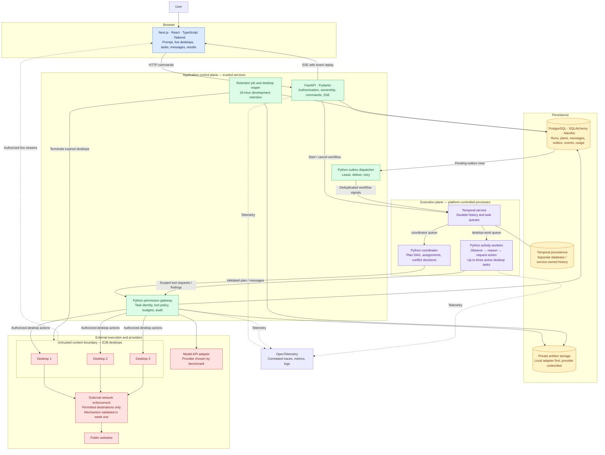
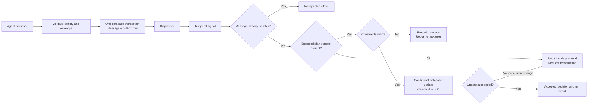

# Visual architecture and technical decisions

Design target: a general-purpose workspace for everyday research and artifact creation, with up to three agents operating isolated desktops. This describes the proposed system, not implemented capabilities.

## System and technology stack



Solid arrows represent commands, data access, or delivery. Dotted arrows represent viewing or telemetry. Arrows to desktops are logical connections through provider APIs; they do not imply unrestricted inbound access to guests. The gateway starts as an internal backend module. Agents cannot directly access application databases or model credentials. Coordinator and activity workers are process roles, not necessarily separate deployments.

## One run, end to end

```mermaid
sequenceDiagram
    actor User
    participant UI as Next.js dashboard
    participant API as FastAPI
    participant DB as PostgreSQL
    participant T as Temporal
    participant C as Coordinator activities
    participant W as Desktop worker activities
    participant G as Permission gateway
    participant E as E2B / model adapters
    participant O as Outbox dispatcher

    User->>UI: Submit goal and constraints
    UI->>API: Create and start run
    API->>DB: Persist run and stable start command
    API->>T: Start workflow using run ID
    Note over API,T: Reconcile uncertain starts using the same workflow ID
    T->>C: Schedule task decomposition activity
    C->>G: Request model-generated task DAG
    G->>E: Authorized model call
    E-->>C: Structured task proposals via gateway
    C->>DB: Validate and persist assignments
    C-->>T: Return validated plan
    T->>W: Schedule ready tasks concurrently
    loop Bounded observe / act steps
        W->>G: Scoped screenshot / model / action request
        G->>DB: Check identity, permissions, deadline, budget
        G->>E: Admit permitted operation
        E-->>W: Result via gateway
        W->>T: Heartbeat progress
    end
    W->>G: Submit finding or proposal
    G->>DB: Atomically save message and outbox row
    O->>DB: Lease pending outbox rows
    O->>T: Signal message ID; duplicates possible
    T->>C: Schedule deduplicated proposal processing
    C->>DB: Accept validated patch at expected version
    DB-->>API: Persisted run events available
    API-->>UI: SSE events and results
    T->>W: Finish / cleanup activities
    UI-->>User: Sourced deliverable and run summary
```

Temporal workflow code controls scheduling deterministically. Model reasoning, SQL operations, and desktop interactions execute in activities or backend services. Findings can unblock work before an entire task finishes. A worker can address another worker through a structured message, but the backend validates and routes it; desktops do not directly exchange credentials or connect to each other.

## Message delivery and conflicting updates



**Example:** two workers propose accommodation against plan version 4. The first accepted update creates version 5. The second update cannot overwrite it using version 4; it must be reevaluated against the current budget and itinerary. If a dispatcher crashes after sending a signal, resending the same message ID must not apply the update twice.

The coordinator chooses among valid tradeoffs. Database transactions enforce concurrency. These are separate responsibilities: model reasoning does not provide transactional consistency.

## Technical decisions and tradeoffs

| Decision | Why it fits this project | Tradeoff / boundary |
|---|---|---|
| General-purpose runtime; dynamic task roles | Demonstrates decomposition and delegation across everyday tasks | First tools support public research and artifacts; general purpose does not mean unrestricted authority |
| Next.js + TypeScript UI, separate Python/FastAPI backend | Combines a clear live interface with Python agent development; runs survive browser disconnects | Two languages and shared contracts; use Pydantic-derived JSON schemas and generated TypeScript types |
| Temporal for orchestration | Durable scheduling, bounded retries, timeouts, cancellation, and failure recovery | Extra service and deterministic workflow rules; arbitrary desktop actions remain capable of uncertain outcomes |
| Explicit Python agent loop | Makes observation, reasoning, tools, and permission admission visible | More loop logic to implement; one orchestration owner avoids overlapping runtime state |
| Two Temporal task queues | Separates coordinator work from desktop-heavy tasks | Queues dispatch execution; they are not agent inboxes or the source of accepted plan state |
| PostgreSQL messages + transactional outbox | Persist a handoff and notification intent atomically | Dispatcher and consumer deduplication required; delivery may repeat |
| One logical coordinator + optimistic concurrency | Gives accepted decisions a clear owner while workers propose and object | Coordinator is a logical serialization point; version checks remain mandatory during retries |
| PostgreSQL for application state | Transactions, uniqueness, ownership queries, versioned updates, and usage accounting | Temporal history stays separately owned; avoid competing sources of truth |
| E2B isolated desktops | Preserves Opticon's visible computer-use experience without building VM infrastructure | Metered external dependency; lost desktop state is not guaranteed recoverable |
| Gateway-enforced task permissions | Agent messages and model output cannot grant authority | All supported operations must pass enforcement; guest network bypass paths must also be closed |
| External egress controls | A tool-name check cannot stop a browser sending data through a URL | Exact mechanism is a week-one feasibility check; destination restrictions alone do not prevent every leak |
| HTTP commands + SSE events | Simple command path and resumable server-to-client updates | Desktop video uses its own authorized stream; event retention/replay must be implemented |
| Immutable artifact references + private storage | Controlled access, provenance, smaller messages, safe handoffs | Storage cleanup and safe previews required; object storage provider remains undecided |
| OpenTelemetry | Makes cross-service failures, retries, and cost drivers explainable | Redact sensitive content; collect operational metadata rather than entire prompts by default |
| Benchmark before model selection | Choose using actual desktop task quality, latency, cost, and attack behavior | Provider and model are intentionally undecided until measured |
| Docker Compose first | Reproducible development within a 48-hour implementation target | Hosted topology must be costed separately; local services still call metered cloud APIs |
| 24-hour development retention | Limits accumulated screenshots and personal research content | Provider retention and backups require separate documentation |

## Reliability, security, and cost limits

| Guarantee we aim to demonstrate | Mechanism | Important limit |
|---|---|---|
| Accepted work survives worker failure | Persisted findings, Temporal recovery, desktop leases | Resume useful task progress; not every browser interaction |
| Repeated delivery does not repeat accepted changes | Stable operation IDs, uniqueness constraints, deduplicated processing | No exactly-once claim for arbitrary external actions |
| Stale work cannot overwrite current decisions | Expected version and transactional conditional update | Semantic conflicts may still need replanning or user input |
| Agents cannot acquire another run's authority | Scoped credentials, ownership checks, artifact access checks | Must also protect desktop-view links, logs, and storage |
| Malicious content cannot authorize protected tools | Gateway policy independent of model text | Prompt-injection resistance is tested per boundary, not universal |
| Resource usage stays bounded | At most three desktops, default ten-minute run deadline, bounded retries, budget reservations, cleanup reaper | Already admitted provider calls can create bounded in-flight spending exposure |

## Deployment and choices still open

Development runs the web app, API, dispatcher, workers, PostgreSQL, Temporal, and observability locally. E2B desktops and model APIs run externally. Background jobs can share an initial process where appropriate; the diagram is a responsibility map, not a requirement for many microservices.

The model provider, authentication implementation, private object storage provider, hosting provider, and exact E2B network enforcement configuration remain implementation choices to verify. They are deliberately not represented as selected products. A public or invite-only hosted deployment proceeds only if measured recurring cost fits the approximately $50/month target.

The first evidence package combines a live weekend-trip task with controlled tests for duplicate messages, simultaneous proposals, worker failure, malicious content, cross-run access, budget/deadline enforcement, dashboard reconnection, and retention. A second everyday task checks generality.

Related documents: [full architecture](architecture.md) and [six-week implementation plan](implementation-plan.md).
